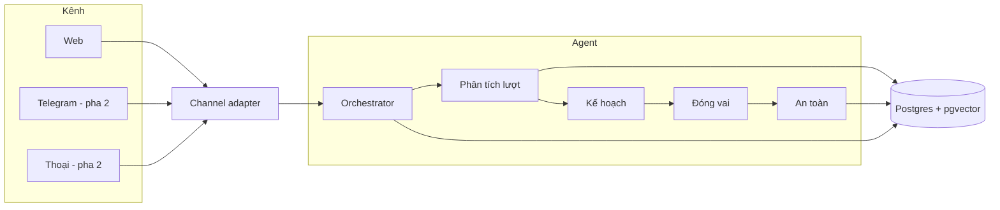

# Giả Nạn

Nền tảng bóc kịch bản lừa đảo tiếng Việt cho MoMo Tech Contest 2026, bảng Anti-fraud. Người dùng biết mình đang bị lừa thì đưa cuộc thoại cho một agent. Agent đóng vai nạn nhân, giữ đối phương nói tiếp, và rút ra kịch bản có cấu trúc. Mỗi cuộc hội thoại thành một hồ sơ trong thư viện dùng để cảnh báo người khác.

Hạn sơ khảo 03/12/2026. Bản này là pha 1, chỉ có web. Telegram (Telethon, MTProto trên chính tài khoản người dùng) và cuộc gọi thoại gắn sau, qua cùng một agent.

## Chạy local

Cần Docker. Đặt khóa vào `.env` (copy từ `.env.example`) nếu muốn đường demo dùng mô hình thật. Không có khóa thì API vẫn lên, giao diện hiện banner «chưa cấu hình khóa» và agent chạy heuristic — không được đem đường đó đi chấm như mô hình thật.

```bash
cp .env.example .env
# sửa GEMINI_API_KEY
docker compose up --build
```

- Giao diện: http://localhost:4178
- API: http://localhost:8091/api/health
- Postgres (pgvector) lộ cổng 5433 cho máy host, user/password/db đều là `gianan`

Không có Docker, chỉ để phát triển giao diện:

```bash
cd backend && python -m venv .venv && . .venv/bin/activate
pip install -r requirements.txt
cd ../frontend && npm install
```

Rồi một terminal `uvicorn app.main:app --app-dir backend --port 8091` với `DATABASE_URL` trỏ Postgres có pgvector, và terminal kia `npm run dev --prefix frontend` (Vite cổng 4178, proxy `/api`). SQLite chỉ dùng cho test, không phải đường chạy demo.

## Demo cho giám khảo

Mở giao diện, bấm **Demo giám khảo**. Một nhịp tạo cuộc gọi giả danh công an với bà Nguyễn Thị Năm. Bấm câu gợi ý hoặc **Tự đi nốt các câu gợi ý**, rồi **Trích xuất**. Nhánh «sống một mình» chưa có trong thư viện nên hồ sơ vào hàng chờ. Bấm **Duyệt ngay** là nó hiện trong thư viện.

Bật **Luận giải của agent** để xem JSON của phân tích, kế hoạch và lớp an toàn từng lượt.

## Kiến trúc



Agent là một vòng bốn nút có hợp đồng Pydantic, không dùng LangGraph. Lý do: luồng này cố định, lớp an toàn và luật «chưa được khép» phải đè được mô hình. Một orchestrator ngắn, mỗi nút là một hàm trên state, test được bằng cách tiêm provider giả. LangGraph thêm một runtime checkpoint không cần cho vòng này, và dễ để mô hình «khép» kịch bản ngay câu chào. Adapter kênh đứng ngoài vòng, nên Telethon và thoại sau này chỉ gọi `handle_turn`.

Thứ tự một lượt:

1. Luật đầu vào: jailbreak và dấu hiệu đối phương đang nghi.
2. Tìm thư viện: embedding (pgvector trên Postgres, cosine trong Python khi test) trộn với từ khóa. Cuộc thoại đang khớp một kịch bản thì không nhảy sang kịch bản khác chỉ vì một cụm trùng, trừ khi kịch bản kia hơn hẳn.
3. Analyst (Gemini Flash, JSON schema): ý định, bước, cờ đỏ, rerank. Bước 0 bị luật đẩy lên nếu heuristic thấy rõ một bước sau.
4. Luật khép: chỉ đề xuất khép khi ba lượt gần nhất cùng một họ kịch bản, độ tin cậy cao, bước đang tiến, và không có nhánh mới.
5. Planner chọn mục tiêu kế tiếp. Máy chủ cấm `close_polite` khi chưa đủ điều kiện khép, và kéo về «giả vờ chưa hiểu» khi có jailbreak.
6. Persona viết tin nhắn tiếng Việt theo hồ sơ giả và trí nhớ.
7. An toàn đầu ra: luật là quyền phủ quyết, kể cả «trả liền», «chuyển liền», «ok em chuyển». Mô hình có thể viết lại. Câu vẫn phạm thì thay bằng câu an toàn trong vai. Cùng lúc kiểm tra cặp đại từ của persona và giọng tao/mày.

Analyst và planner chạy song song vì cả hai chỉ cần gói tìm thư viện. Persona đợi mục tiêu. Bốn lần gọi mỗi lượt đều tắt thinking (`thinking_budget=0`, khoảng 0,7 giây trên `gemini-2.5-flash`) để một lượt ở dưới 4 giây. Chỉ lúc trích kịch bản cuối cuộc mới bật thinking. 503 và timeout được thử lại với backoff ngắn rồi chuyển model.

Nhánh mới là hoàn cảnh riêng của persona (con ở Đức, sống một mình, shop, học phí…) mà kịch bản đang khớp và các biến thể của nó không có. Nếu thư viện đã có biến thể đó, UI báo «khớp nhánh đã có» và tiếp tục bám nhánh.

## Mô hình

| Vai | Mặc định | Ghi chú |
| --- | --- | --- |
| Agent | `gemini-2.5-flash` | JSON schema. Thinking tắt ở mỗi lượt (`thinking_budget=0`), bật khi trích kịch bản cuối cuộc |
| Embedding | `gemini-embedding-2` hoặc `gemini-embedding-001` | Xin `outputDimensionality=768` rồi chuẩn hóa. Cột `vector(768)` |
| Dự phòng | `gpt-6-luna` và `text-embedding-3-small` | Chỉ khi Gemini lỗi hoặc không có khóa Gemini |
| Không khóa | Mock | Chỉ test tự động và banner «chưa cấu hình khóa» |

`LLM_PROVIDER=auto` chọn Gemini, rồi OpenAI, rồi mock. Đặt `gemini` hoặc `openai` để ép. Provider thật không bao giờ rơi xuống mock giữa chừng: lỗi mô hình trả 502.

## Biến môi trường

| Biến | Ý nghĩa |
| --- | --- |
| `GEMINI_API_KEY` | Khóa Google AI Studio. Cần cho demo thật |
| `OPENAI_API_KEY` | Dự phòng, không bắt buộc |
| `LLM_PROVIDER` | `auto` (mặc định), `gemini`, `openai`, `mock` |
| `GEMINI_MODEL` | Mặc định `gemini-2.5-flash`. Không dùng `gemini-2.5-flash-lite` (404, bị đổi về 2.5-flash) |
| `GEMINI_MODEL_PREFERRED` | Tuỳ chọn, ví dụ `gemini-3.5-flash`. 503, timeout hoặc 404 thì rơi về `GEMINI_MODEL` |
| `GEMINI_MODEL_FALLBACK` | Mặc định `gemini-2.5-flash` |
| `GEMINI_EMBED_MODEL` | Mặc định `gemini-embedding-2`. `gemini-embedding-001` cũng được, cùng chiều 768 |
| `OPENAI_MODEL` | Mặc định `gpt-6-luna` |
| `OPENAI_EMBED_MODEL` | Mặc định `text-embedding-3-small` |
| `DATABASE_URL` | `postgresql+psycopg://...`. `postgres://` của Render/Railway được đổi sang driver psycopg |
| `ADMIN_TOKEN` | Nếu đặt, hàng chờ duyệt cần header `X-Admin-Token`. Để trống thì cửa demo mở và UI nói rõ |

## Việc đã có

- Hội thoại tiếp quản, persona chọn được, độ trễ gõ và dấu đang nhập.
- Panel: kịch bản khớp, bước hiện tại, cờ đỏ, nhánh mới, mục tiêu, luận giải bật tắt.
- Thư viện dạng cây, lọc, tìm, thẻ cảnh báo tải PNG.
- Kiểm tra tin: mức rủi ro, bước kế, nút giao cho agent.
- Xu hướng theo loại, tháng, thương hiệu.
- Hàng chờ duyệt.
- Demo một nhịp cho giám khảo.
- 28 kịch bản gốc và các nhánh, viết từ kiến thức công khai. Không có đường dẫn lừa sống.
- Script nhập Hugging Face `trannguyenthaituan/vietnamese_sms_dataset` (`message_id`, `date`, `message`, `label`) và Kaggle `ngovanhh/vi-fraud-bench-vi` (`vi_fraud_pool.jsonl`: `id`, `source`, `text`, `y`, `group`). Không tải và không commit dữ liệu lớn.

```bash
cd backend
python scripts/import_public_datasets.py --source huggingface --path ./full_dataset.csv
python scripts/import_public_datasets.py --source kaggle --path ./vi_fraud_pool.jsonl --load --limit 40
```

`--download` với Hugging Face cần `pip install huggingface_hub`. Kaggle tải bằng CLI và tài khoản của bạn.

## Test và eval

```bash
cd backend
pytest
python -m eval.run
```

`pytest` dùng SQLite và provider mock. Eval chạy năm tình huống (công an, MoMo, việc nhẹ, shipper, phá vai) qua đúng API. Báo cáo nằm ở `eval/results/report.md`. Không có khóa thì báo cáo ghi rõ đang mock. Có `GEMINI_API_KEY` thì bộ mô phỏng kẻ lừa cũng là mô hình thật.

Lần chạy trong repo này, không có khóa:

- Khớp đúng kịch bản ở lượt cuối: 4/4
- Độ phủ bước trung bình: 88%
- Còn trong vai: 15/15
- Lọt an toàn: 0

## Đưa lên mạng

Giám khảo cần một URL sống tới 11/12/2026. Repo này không kèm tài khoản Render, Railway hay Fly. Cách chắc nhất là một VPS:

```bash
git clone <repo>
cp .env.example .env   # điền GEMINI_API_KEY và ADMIN_TOKEN
docker compose up -d --build
```

Mở cổng 4178, hoặc sửa compose để `web` nghe cổng 80. Dữ liệu nằm ở volume `pgdata`.

**Render.** `render.yaml` khai hai service Docker và một Postgres. Sau khi có DB, chạy `CREATE EXTENSION IF NOT EXISTS vector;` nếu gói cho phép. `DATABASE_URL` dạng `postgres://` được chuẩn hóa trong code. Đặt `GEMINI_API_KEY`. Nếu Postgres của Render không có pgvector, đừng dùng blueprint này — dùng VPS.

**Railway.** Hai service từ `backend/Dockerfile` và `frontend/Dockerfile`, cộng plugin Postgres. Biến giống `.env.example`. Service web không cần biết URL API vì nginx trong image proxy `/api` tới hostname `api`. Trên Railway hãy đặt tên service API là `api`, hoặc sửa `frontend/nginx.conf` cho đúng hostname nội bộ rồi build lại.

**Fly.** `fly.toml` là app API (region `sin`, không tự tắt máy). Tạo Postgres có image pgvector, rồi:

```bash
fly secrets set GEMINI_API_KEY=... DATABASE_URL=postgresql+psycopg://... ADMIN_TOKEN=...
fly deploy
```

App web là Fly app thứ hai, build `frontend/Dockerfile`. Hai app không chung mạng Docker, nên nginx `api:8000` không chạy trên Fly. Với Fly, trỏ `frontend/nginx.conf` tới URL công khai của API rồi build, hoặc phục vụ cả hai bằng compose trên một máy.

## Thư viện mã nguồn mở

Backend: FastAPI, Uvicorn, SQLAlchemy, psycopg, pgvector, Pydantic, pydantic-settings, google-genai, openai, pytest.

Frontend: React, Vite, TypeScript, Tailwind CSS, Radix UI (Dialog, Slot), class-variance-authority, lucide-react, html-to-image, react-router.

Hạ tầng: Postgres 16 với pgvector, nginx.

## Công cụ AI đã dùng

Đây là mục contest yêu cầu khai báo.

- Sản phẩm chạy bằng Google Gemini (`gemini-2.5-flash`, có thể thử `gemini-3.5-flash` rồi tự về 2.5-flash; embedding `gemini-embedding-2`) và, nếu bật, OpenAI (`gpt-6-luna`, `text-embedding-3-small`).
- Mã nguồn của repo này được viết với Cursor, mô hình Grok 4.7, trong một cloud agent. Không có khóa Gemini hay OpenAI trong môi trường lúc build, nên eval đã commit chạy bằng mock. Đường mô hình thật đã nối đủ schema JSON, embedding và fallback; cần khóa để kiểm lại bằng tay.

## Pha 2, chưa làm

- `TelegramChannel.connect_userbot()` ném `NotImplementedError`. Adapter đã chuẩn hóa tin đã giải mã để agent không phải viết lại.
- Thoại nhận bản ghi (`transcript`). Chưa nhận cuộc gọi, chưa TTS.
- Hàng chờ duyệt không có tài khoản người dùng. `ADMIN_TOKEN` là khóa chung. Gắn auth trước khi public.
