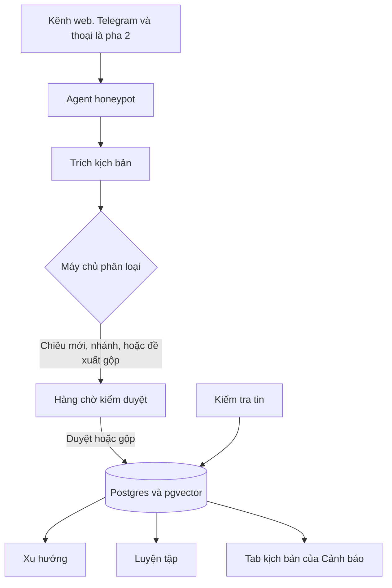
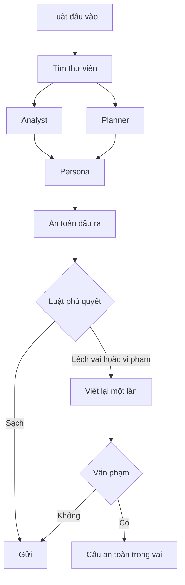
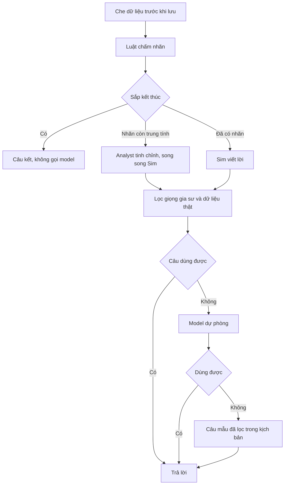

# Honeypot

Honeypot là nền tảng tiếng Việt cho MoMo Tech Contest 2026, bảng Anti-fraud. Agent đóng vai nạn nhân (Giả Nạn), giữ đối phương nói tiếp và rút ra kịch bản có cấu trúc. Kịch bản qua hàng chờ kiểm duyệt rồi vào thư viện, để cảnh báo người khác, theo dõi xu hướng, và cho người dân luyện tập mô phỏng. Hạn sơ khảo 03/12/2026. Bản này là pha 1, chỉ có web.

## Tính năng chính

- **Kiểm tra tin** (`/`): dán tin nhắn, số điện thoại, số tài khoản, đường dẫn hoặc ví. Kết quả có điểm rủi ro, kịch bản khớp, cờ đỏ và lời khuyên, kèm lối sang luyện đúng tình huống đó.
- **Luyện tập** (`/luyen-tap`): mô phỏng hội thoại trên kịch bản đã xuất bản, chín nhóm, độ khó Dễ / Vừa / Khó, chế độ Học hoặc Thử thách. Trắc nghiệm tám câu ở `/luyen-tap/trac-nghiem`.
- **Cảnh báo** (`/canh-bao`): thẻ chiêu đang lưu hành, và tab kịch bản chi tiết. Trang kịch bản tải được thẻ PNG.
- **Xu hướng** (`/xu-huong`): số vụ theo loại, tháng và thương hiệu, kèm phương thức đang nổi.
- **Báo cáo** (`/bao-cao`): dán tin để đối chiếu kho, rồi có thể giao cuộc thoại cho agent.
- **Bị lừa** (`/bi-lua`): bốn việc cần làm ngay sau khi chuyển tiền hoặc làm theo người lạ, gồm cảnh giác chiêu hứa lấy lại tiền.
- **Phòng phân tích** (`/phan-tich`): hội thoại, mạng lưới chỉ dấu, hàng chờ kiểm duyệt, demo giám khảo và trạng thái hệ thống.

Thanh trên có Trang chủ, Luyện tập, Cảnh báo, Xu hướng, nút Báo cáo lừa đảo, và liên kết Phòng phân tích. Điện thoại có bốn mục dưới cùng: Trang chủ, Luyện tập, Cảnh báo, Báo cáo. Khi chưa gắn khóa, chân trang ghi «Chế độ mô phỏng — chưa gắn khóa model».

## Chạy nhanh

Cần Docker. Copy `.env.example` thành `.env` rồi điền khóa nếu muốn mô hình thật. Không có `LLM_API_KEY` (hoặc `OPENAI_API_KEY`) và `GEMINI_API_KEY` thì API vẫn lên ở chế độ mô phỏng: giao diện hiện banner, agent chạy heuristic. Đường đó không dùng để chấm như mô hình thật. `LLM_PROVIDER=mock` cũng vào chế độ này.

```bash
cp .env.example .env
docker compose up -d --build
```

| Dịch vụ | Địa chỉ |
| --- | --- |
| Giao diện | http://localhost:4178 |
| API | http://localhost:8091/api/health |
| Postgres (pgvector) | `localhost:5433`, user / mật khẩu / db đều là `gianan` |

Trong Compose, service và container là `honeypot-db`, `honeypot-api`, `honeypot-web`. API trong mạng nội bộ nghe cổng 8000, nginx của web proxy `/api` tới `honeypot-api`.

Cập nhật bản đang chạy:

```bash
git pull && docker compose up -d --build
```

Compose chỉ chuyển vào container các biến khai trong `docker-compose.yml` (khóa, model từng vai, `MODEL_SIM` và timeout của vai đó, Gemini, `ADMIN_TOKEN`). Các biến còn lại dùng mặc định trong `backend/app/config.py`. Bảng đầy đủ nằm ở [docs/bien-moi-truong.md](docs/bien-moi-truong.md). Cách chạy không Docker, demo giám khảo và đưa lên mạng nằm ở [docs/trien-khai.md](docs/trien-khai.md).

## Pipeline

Ba sơ đồ dưới đây bám mã hiện tại: vòng agent trong `backend/app/agent/orchestrator.py`, trích và duyệt trong `backend/app/services/library.py`, luyện tập trong `backend/app/services/training.py`.

### Tổng quan



1. Kênh đi qua adapter rồi gọi cùng một `handle_turn`. Pha 1 chỉ có web. Telegram và thoại đã có adapter, chưa nối vận chuyển thật.
2. Hết hội thoại, người dùng bấm trích xuất. Mô hình viết hồ sơ. Máy chủ phân loại một lần trên toàn bộ lời kẻ lừa, rồi đối chiếu với kết quả tìm của từng lượt. Khớp chắc một họ thì là nhánh (khi có hoàn cảnh mới) hoặc đề xuất gộp. Không khớp chắc thì là kịch bản gốc mới. Mọi kết quả đều vào hàng chờ `pending`, kể cả đề xuất gộp.
3. Duyệt chuyển bản chờ sang `published` và gắn embedding. Với đề xuất gộp, người duyệt chọn gộp vào kịch bản đích (bản chờ thành `merged`) hoặc công bố riêng. Từ chối thì `rejected`. Không gì vào thư viện công khai mà không qua người duyệt.
4. Xu hướng, tab kịch bản và luyện tập đọc thư viện đã xuất bản. Kiểm tra tin cũng đối chiếu thư viện đó. Thẻ cảnh báo công khai là nội dung soạn sẵn trong `backend/app/data/warnings.py`, có liên kết sang kịch bản cùng nhóm.
5. Luyện tập chỉ đọc kịch bản. Một phiên luyện không tạo kịch bản mới và không ghi chỉ dấu.

### Một lượt của agent honeypot



1. Luật đầu vào (`assess_inbound`) đánh dấu jailbreak và dấu hiệu đối phương đang nghi. Số lạ được ghi vào hồ sơ vụ.
2. Tìm thư viện đã xuất bản: embedding pgvector trộn với từ khóa. Cuộc thoại đang bám một kịch bản thì giữ kịch bản đó, trừ khi kịch bản khác hơn ít nhất 0.22 điểm. Kết quả thô của mỗi lượt được ghi lại. Nếu chưa có họ nào được xác lập (một lượt ≥ 0.75, hoặc hai lượt ≥ 0.55), lượt chạy ở chế độ **chưa khớp**: Planner không nhận kịch bản, agent hỏi theo playbook chung (họ là ai, muốn gì, chuyển vào đâu, link, app, hạn chót). Agent không cần biết trước kịch bản.
3. Analyst và Planner chạy song song, vì cả hai chỉ cần gói tìm kiếm. Analyst đọc ý định, bước và cờ đỏ. Planner chọn mục tiêu. Vai nào không trả lời thì lượt giữ mạch cũ.
4. Máy chủ quyết định có được khép kịch bản hay không. `close_polite` bị kéo về hỏi tiếp khi chưa đủ điều kiện. Jailbreak hoặc nghi ngờ cao chuyển mục tiêu sang giả vờ chưa hiểu.
5. Khi kẻ lừa đưa số tài khoản hoặc ví, máy chủ cho persona đọc lại số đó để họ xác nhận và nói tên chủ tài khoản. Khi mọi số đã xác nhận, persona viện một trở ngại vô hại để hỏi cách nhận khác. Số chỉ được tính là đã xác nhận khi kẻ lừa nhắc lại hoặc đồng ý sau khi nghe đọc lại.
6. Persona viết một tin tiếng Việt theo hồ sơ giả và hồ sơ văn phong (độ dài, viết tắt, viết thường, thói quen), biết giờ Việt Nam và khoảng lặng từ tin trước. Sau lớp an toàn, `humanize` chỉnh câu cho giống cách người đó gõ.
7. Guard duyệt câu nháp ngay khi có nháp. Nếu luật chê câu (nhận chuyển tiền, nhận đã cài, nhận là máy, giọng dạy đời, sai đại từ, lặp câu mở, lặp ý với các tin trước), persona viết lại một lần, rồi câu mới được duyệt lại. Luật vẫn phủ quyết: câu còn vi phạm cứng thì thay bằng câu an toàn trong vai. Guard không trả lời thì không gửi bản nháp.

Điều kiện khép, nhánh mới, playbook và cách trộn điểm embedding nằm ở [docs/kien-truc-chi-tiet.md](docs/kien-truc-chi-tiet.md). Các chiến thuật đọc lại số, hỏi cách khác, đồng hồ, chống lặp và giọng người thật, cùng nguồn tham khảo, nằm ở [docs/cai-tien-agent.md](docs/cai-tien-agent.md).

### Một lượt luyện tập



1. Câu người chơi được che trước khi lưu: OTP, số thẻ, căn cước, số điện thoại, mật khẩu, tên và địa chỉ thành `[ĐÃ CHE]`. Nhãn do luật gán trên câu gốc: `refuse`, `verify`, `suspicious`, `comply`, `leak`, `fell`, `neutral`.
2. Luật thắng khi nhãn không còn trung tính. Analyst chỉ được gọi lúc nhãn là `neutral`, và không được hạ một cú ngã (`fell`, `leak`). Analyst chạy song song với Sim trong trường hợp đó. Nếu lượt sắp kết thúc thì không gọi model.
3. Sim viết tối đa hai câu, đúng vai người đang gọi. Câu bị loại nếu mang giọng gia sư (cảnh báo, xin lỗi, nhận là AI) hoặc còn số dài, đường dẫn, ví, ID điều khiển, tên chủ tài khoản.
4. Lần đầu lỗi thì gọi model dự phòng của vai `sim`. Vẫn không dùng được thì lấy câu mẫu đã lọc sẵn trong kịch bản.
5. Điểm cuối bài do luật tính. Chín nhóm: công an, ngân hàng và ví, giao hàng, việc làm, đầu tư, QR, deepfake, cài app, khác. Dễ / Vừa / Khó là 10 / 12 / 14 lượt, và 0 / 1 / 2 lần được trấn an tại chỗ. Học lộ cờ đỏ. Thử thách chỉ đếm cờ. Phiên cũ hơn bảy ngày bị xóa lúc khởi động.

## Mô hình

Mọi vai chat đi qua router tương thích OpenAI (9router) tại `OPENAI_BASE_URL`. Model để trống thì dùng `OPENAI_MODEL`. Hết giờ, JSON hỏng hoặc HTTP lỗi thì đổi một lần sang model dự phòng của vai đó, không gọi lại cùng model, rồi mới sang Gemini nếu có khóa.

| Vai | Model | Dự phòng | Trần thời gian |
| --- | --- | --- | --- |
| Persona | `cx/gpt-6-luna` | `cx/gpt-5.6-luna` | 12 giây, dự phòng 10 giây |
| Analyst | `ag/gemini-3.8-flash-low` | `cx/gpt-5.6-luna` | 18 giây, dự phòng 12 giây |
| Planner | `ag/gemini-3.8-flash-low` | `cx/gpt-5.6-luna` | 18 giây, dự phòng 12 giây |
| Guard | `ag/gemini-3.8-flash-low` | `cx/gpt-5.6-luna` | 9 giây, dự phòng 7 giây |
| Trích kịch bản | `cx/gpt-5.6-luna` | `cx/gpt-6-luna` | 30 giây, dự phòng 20 giây |
| Giọng luyện tập (`sim`) | `ag/gemini-3.8-flash-low` | `cx/gpt-5.6-luna` | 7 giây, dự phòng 5 giây |
| Chat dự phòng Gemini | `gemini-2.5-flash` | `gemini-2.5-flash` | theo lần gọi |
| Embedding | `openrouter/openai/text-embedding-3-small` | để trống: lỗi thì tìm theo từ khóa | 6 giây một câu |

Cả lượt honeypot có trần `TURN_DEADLINE` 25 giây. `GET /api/health/llm` là ping làm nóng lúc khởi động. Embedding mặc định 768 chiều qua `/v1/embeddings`. Chi tiết failover, cosine và gắn lại vector nằm ở [docs/kien-truc-chi-tiet.md](docs/kien-truc-chi-tiet.md).

## An toàn và quyền riêng tư

Agent không được nhận chuyển tiền, nhận đã cài phần mềm, hay đọc OTP thật. Luật đầu ra chặn các cam kết đó. Khi mục tiêu là đọc mã, câu gửi đi chỉ chứa OTP giả sinh từ id cuộc thoại.

Trong luyện tập, Sim chỉ được viết số và đường dẫn bằng placeholder: `[SỐ_GIẢ]`, `[STK_GIẢ]`, `[NGÂN_HÀNG]`, `[LINK_GIẢ]`, `[VÍ_GIẢ]`, `[ID_GIẢ]`, `[APP_GIẢ]`, `[TÊN_GIẢ]`. Lời người chơi được che bằng `[ĐÃ CHE]` trước khi lưu. Phiên luyện không ghi vào thư viện và không tạo chỉ dấu.

Hàng chờ duyệt cần header `X-Admin-Token` khi `ADMIN_TOKEN` được đặt. Để trống thì cửa demo mở, và giao diện nói rõ cần khóa trước khi đưa lên mạng.

48 kịch bản gốc (33 trong `scripts.py`, 15 trong `scripts_2026.py`) được nạp lúc khởi động. Câu chữ theo mẫu công khai. Số, tên miền, ví và tên file trong bộ 2026 là placeholder, không phải chỉ dấu đang sống.

## Cấu trúc thư mục

```text
backend/app/agent/       vòng một lượt: orchestrator, policy, prompts
backend/app/api/         HTTP, gồm routes.py và training.py
backend/app/channels/    web, telegram, voice
backend/app/services/    thư viện, kiểm tra, xu hướng, luyện tập, chỉ dấu
backend/app/llm/         router, Gemini, mock
backend/app/data/        kịch bản, persona, thẻ cảnh báo, câu trắc nghiệm an toàn
backend/tests/           pytest, SQLite, provider mock
backend/eval/            mười bốn tình huống hội thoại, gồm bốn chiêu không có trong thư viện
frontend/src/            React, Vite
docs/                    kiến trúc, biến môi trường, triển khai
docker-compose.yml
.env.example
```

## Kiểm thử và đánh giá

```bash
cd backend
pytest
python -m eval.run
```

`pytest` gồm 199 hàm test (454 ca khi tính cả ca tham số hóa) trong `backend/tests`. Môi trường test dùng SQLite và `LLM_PROVIDER=mock`, có `tests/test_training.py` cho việc che dữ liệu, điểm, điều kiện kết thúc, lời kẻ lừa và trắc nghiệm.

Báo cáo hội thoại đã commit ở `eval/results/report.md` (2026-11-27, nhà cung cấp mock, mười bốn tình huống). Ba tình huống là chiêu không có trong 48 kịch bản gốc (phạt nguội CSGT, trợ lý bác sĩ bán thuốc, nhờ bình chọn để chiếm Facebook). Một tình huống ranh giới (hãng bay hoàn vé, cùng cơ chế với Shopee hoàn tiền) không chấm.

| Chỉ số | Giá trị |
| --- | --- |
| Khớp đúng kịch bản ở lượt cuối | 8/8 |
| Độ phủ bước trung bình | 85% |
| Lượt còn trong vai | 52/52 |
| Lọt an toàn ở câu đã gửi | 0 |
| Phân loại đúng lúc trích xuất | 11/11 |
| Lượt chạy chế độ chưa khớp, chiêu mới | 12/12 |
| Lượt chạy chế độ chưa khớp nhầm, chiêu đã biết | 0/29 |
| Chỉ dấu moi được (tài khoản, đường dẫn) | 7/7 |
| Nơi nhận tiền được xác nhận | 2/8 |
| Độ mới trung bình của câu trả lời | 97% |
| Câu có dấu hiệu văn máy | 1/52 |

Nơi nhận tiền 2/8 là vì trên mock phần lớn tình huống đưa số ở câu cuối, không còn lượt để xác nhận. Cùng bộ tình huống chạy trên mã trước khi thêm chế độ chưa khớp cho 10/11 phân loại đúng và 0/12 lượt chưa khớp. Chiêu bình chọn bị xếp trùng và gộp thẳng vào một kịch bản đã xuất bản. Các ngưỡng nằm ở `backend/app/services/matching.py`, mới chỉnh trên đường mock (chỉ từ khóa), nên phải đo lại khi có embedding thật. Kế hoạch và lý do ở [docs/ke-hoach-kich-ban-moi.md](docs/ke-hoach-kich-ban-moi.md).

Lần chạy đó không có khóa API. Agent vẫn đi đủ vòng trên lớp heuristic, và báo cáo ghi rõ điều đó. Một lần `python -m eval.run` mới ghi ra thư mục tạm, hoặc đường `EVAL_OUT` nếu đặt biến này.

`eval/training_live.md` ghi một lần kiểm luyện tập cũng không có khóa router hay Gemini, nên repo chưa có số đo độ trễ hay tỷ lệ đúng vai trên mô hình thật. Các ca mock của luyện tập nằm trong `tests/test_training.py`. File đó yêu cầu, khi có khóa, chạy lại ít nhất ba phiên cho mỗi kiểu kết (`safe`, `scammed`, `timeout`) trên ít nhất năm nhóm, và theo dõi trung vị độ trễ từng lượt (mục tiêu dưới 6 giây), chỉ với `MODEL_SIM` và `MODEL_ANALYST` đã cấu hình.

## Tài liệu chi tiết

- [docs/kien-truc-chi-tiet.md](docs/kien-truc-chi-tiet.md) — điều kiện khép, nhánh, playbook, embedding, failover.
- [docs/bien-moi-truong.md](docs/bien-moi-truong.md) — bảng biến môi trường.
- [docs/trien-khai.md](docs/trien-khai.md) — chạy không Docker, demo giám khảo, VPS, Render, Railway, Fly, nhập dữ liệu công khai.

## Thư viện mã nguồn mở

Backend: FastAPI, Uvicorn, SQLAlchemy, psycopg, pgvector, Pydantic, pydantic-settings, google-genai, openai, httpx, python-dotenv, pytest.

Frontend: React, Vite, TypeScript, Tailwind CSS, Radix UI (Dialog, Slot, Tabs, Tooltip), class-variance-authority, clsx, tailwind-merge, lucide-react, html-to-image, react-router. Lint bằng oxlint. Smoke giao diện dùng Playwright.

Hạ tầng: Postgres 16 với image `pgvector/pgvector`, nginx.

## Công cụ AI đã dùng

Mục này khai báo theo yêu cầu cuộc thi.

- Hội thoại, phân tích, lập kế hoạch, lớp an toàn, trích kịch bản và giọng luyện tập đi qua router tương thích OpenAI tại `OPENAI_BASE_URL`. Model từng vai nằm ở bảng phía trên. Embedding mặc định `openrouter/openai/text-embedding-3-small` qua `/v1/embeddings`.
- Gemini `gemini-2.5-flash` là dự phòng chat khi router lỗi, và là đường embedding khi `EMBED_PROVIDER` chọn Gemini.
- Mã nguồn được viết bằng Cursor, mô hình Grok 4.7, trên Cursor cloud agent. Bản eval đã commit chạy mock vì môi trường lúc đó không có khóa. Tài liệu này cũng được soạn bằng Cursor cloud agent, đối chiếu trực tiếp mã trong repo.

## Lộ trình

Pha 2, chưa làm:

- `TelegramChannel.connect_userbot()` ném `NotImplementedError`. Adapter đã chuẩn hóa tin đã giải mã để agent không phải viết lại. Pha 2 gắn Telethon, MTProto trên chính tài khoản người dùng.
- Thoại nhận bản ghi (`transcript`). Chưa nhận cuộc gọi, chưa có TTS.
- Hàng chờ duyệt dùng một `ADMIN_TOKEN` chung, chưa có tài khoản người dùng. Gắn auth trước khi public.
